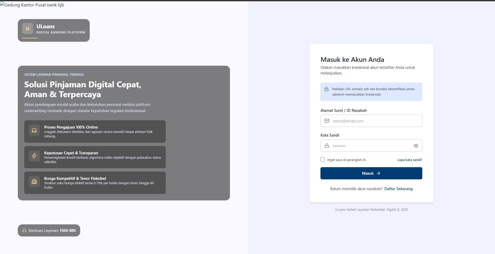

# ULoans

ULoans is a full-stack loan application platform. It allows users to create an
account, sign in, submit loan applications, review their application history,
open application details, and cancel eligible pending applications.

The project is built as two applications:

- A React and Vite frontend for the user experience.
- An Express REST API with Prisma and PostgreSQL for authentication, loan
  workflows, and data persistence.

## Project Status

This project is under active development. The main customer loan workflow is
implemented, including authentication, protected routes, loan applications,
loan history, loan details, and cancellation of pending applications.

## Screenshots

Screenshots can be added to the paths below:

### Login



### Customer dashboard


> These images are optional portfolio assets. Add screenshots without personal
> information, real credentials, private tokens, or sensitive customer data.

## Features

- User registration and login
- JWT-protected API routes
- Protected frontend routes
- Customer loan dashboard
- Loan application form
- Loan history with status filters
- Loan detail view
- Cancellation of pending loan applications
- Loading, empty, validation, and error states
- Responsive frontend layout
- PostgreSQL persistence through Prisma

## Technology Stack

### Frontend

- React
- Vite
- React Router
- Axios
- Tailwind CSS

### Backend

- Node.js
- Express
- JSON Web Token
- Prisma
- PostgreSQL

## Architecture

```text
Browser
  |
  v
React/Vite frontend
  |
  v
Axios API client
  |
  v
Express REST API
  |
  +--> JWT authentication middleware
  |
  +--> Controllers
  |
  +--> Services and repositories
  |
  v
Prisma
  |
  v
PostgreSQL
```

The repository is organized into separate frontend and backend applications:

```text
.
├── uloan-express/
│   ├── prisma/
│   ├── src/
│   └── server.js
└── uloans-frontend/
    ├── src/
    ├── public/
    └── vite.config.js
```

## Requirements

- Node.js 18 or newer
- npm 9 or newer
- PostgreSQL for database-backed local development

Check your installed versions:

```bash
node --version
npm --version
```

## Local Setup

### 1. Clone the repository

```bash
git clone <your-public-repository-url>
cd ulons-apps
```

### 2. Configure the backend

```powershell
cd uloan-express
copy .env.example .env
npm install
npm run prisma:generate
npm run prisma:deploy
```

Update `.env` with local values. The actual `.env` file is intentionally
ignored by Git. Never publish database credentials or JWT secrets.

The backend environment requires values such as:

```env
PORT=8080
JWT_SECRET=<local-development-secret>
DATABASE_URL=<local-postgresql-connection-string>
FRONTEND_URL=http://localhost:5173
```

The placeholder values above are examples only. Use your own local
configuration.

### 3. Configure the frontend

Open a second terminal:

```powershell
cd uloans-frontend
copy .env.example .env
npm install
```

Set the frontend API URL in `.env`:

```env
VITE_API_URL=http://localhost:8080/api/v1
```

### 4. Start the applications

Start the backend:

```powershell
cd uloan-express
npm start
```

Start the frontend in a second terminal:

```powershell
cd uloans-frontend
npm run dev
```

Open the frontend URL shown by Vite, usually:

```text
http://localhost:5173
```

The backend health check is available at:

```text
http://localhost:8080/health
```

## Main API Endpoints

The API uses the `/api/v1` prefix.

| Method | Endpoint | Authentication | Description |
| --- | --- | --- | --- |
| `POST` | `/auth/register` | Public | Register a user |
| `POST` | `/auth/login` | Public | Authenticate a user |
| `GET` | `/user/profile` | Required | Get the current user profile |
| `POST` | `/loans` | Required | Create a loan application |
| `GET` | `/loans` | Required | Get the current user's loans |
| `GET` | `/loans/:loanId` | Required | Get one loan application |
| `POST` | `/loans/:loanId/cancellation` | Required | Cancel a pending application |

Authentication-protected requests use the token returned by the login endpoint.
Do not include real tokens in documentation, screenshots, issues, or commits.

## Loan Rules

- The minimum loan amount is `500000`.
- The backend remains authoritative for validation and authorization.
- Only the owner of a loan can access or cancel it.
- Only a loan with `PENDING` status can be cancelled.
- Supported loan statuses include `PENDING`, `APPROVED`, `REJECTED`, and
  `CANCELLED`.

## Available Commands

### Backend

Run these commands from `uloan-express`:

| Command | Description |
| --- | --- |
| `npm start` | Start the API server |
| `npm run dev` | Start the API server in watch mode |
| `npm run prisma:generate` | Generate the Prisma client |
| `npm run prisma:deploy` | Apply production-style migrations |
| `npm test` | Run the backend test suite |
| `npm run test:integration:all` | Run integration tests |

### Frontend

Run these commands from `uloans-frontend`:

| Command | Description |
| --- | --- |
| `npm run dev` | Start the Vite development server |
| `npm run build` | Create a production build |
| `npm run preview` | Preview the production build |
| `npm run lint` | Run ESLint |

## Deployment

The recommended deployment layout is:

```text
Frontend: Vercel
Backend: Render, Railway, or another Node.js host
Database: Managed PostgreSQL provider
```

For the frontend deployment, configure:

```env
VITE_API_URL=https://<backend-domain>/api/v1
```

For the backend deployment, configure environment variables in the hosting
provider's secret manager:

```env
DATABASE_URL=<managed-postgresql-connection-string>
JWT_SECRET=<production-secret>
FRONTEND_URL=https://<frontend-domain>
```

Do not commit any production values to this repository. Update the backend
CORS origin to the deployed frontend domain before testing the production
integration.

## Security Notes

- `.env` files and agent instruction files are excluded by the root
  `.gitignore`.
- `.env.example` files contain placeholders only and are safe to share.
- Never commit passwords, database connection strings, JWT secrets, access
  tokens, private keys, or personal customer data.
- Frontend route protection improves user experience; backend middleware must
  enforce authentication and ownership.
- Use a separate demo account and sanitized demo data for portfolio reviews.

## Portfolio Demo

For a public portfolio presentation, provide:

- A live frontend URL.
- A public source repository URL.
- A backend health-check URL, if appropriate.
- Sanitized screenshots of the login page and customer dashboard.
- A short explanation of the architecture and authentication flow.

Do not publish private deployment URLs, database credentials, secret values, or
real user information.

## License

No license has been specified yet.
